# Charybdis Mini: migrated keymap without Argos

This userspace builds `mykeymap` for `bastardkb/charybdis/3x6/splinktegrated_rev1` (RP2040).
The original source remains in `../qmk_userspaceBU`, including its old UF2.
Firmware source is pinned to `bc50f889c80773e96bfcb1249f137b676cf0eb5f` in the build workflow.

## Rebuild locally

The sibling `qmk-build-env`, `bastardkb-qmk-no-argos`, and Arm GNU 14.2.Rel1 directories contain the isolated build environment prepared for this migration. The Bash build script saves `user.qmk_home` and `user.overlay_dir` in your QMK configuration, changes into this userspace, and runs a clean compile (`qmk compile -c`).

```sh
cd ~/Downloads/qmk_userspace-no-argos
./build.sh
```

The UF2 is copied to this userspace directory. To use another QMK checkout, set `QMK_HOME` when running the script. For another machine, install QMK's build dependencies, clone the pinned firmware and its submodules, and configure this directory as QMK userspace. GitHub Actions is configured for this one target; pushing this userspace triggers the firmware build workflow.

## Keymap diagram



Regenerate the diagram after editing `keymap.c`:

```sh
./draw-keymap.sh
```

The prepared QMK environment includes keymap-drawer. On another machine, install `keymap-drawer/requirements.txt` into your QMK Python environment and set `QMK_HOME` to the firmware checkout. Drawing does not require the Arm compiler or a firmware build.

The diagram is generated from the C keymap and its combo definitions. Named layers and custom legends are preserved, including home-row modifiers, trackball modes, DPI controls, and the Mission Control/Maximize tap dance. Base combos are shown on Base; combos using keys explicitly assigned to other layers are shown on those layers. Their actual activation follows QMK's combo handling. Encoder actions remain listed in `keymap.c` and are not shown in the key diagram.

`keymap-drawer/config.yaml` controls legends and appearance; `annotations.yaml` labels combo actions. Generated YAML and the local physical layout JSON are saved alongside the SVG. The drawing workflow generates downloadable artifacts and checks that the committed preview matches the current keymap. Run the drawing command and commit its outputs along with keymap edits.

## Preserved behavior

- Five layers, all home-row modifiers and layer taps, five combos, both tap-dance definitions, and the NEWLINE macro.
- Left encoder on GP20/GP23, direction flip and resolution 2, with the original per-layer actions.
- Caps Lock red; lower green, raise cyan, pointer purple; brightness limit 130 and split RGB synchronization.
- Manual pointer-layer activation. Automatic pointer-layer activation remains off.
- Sniping activates on the configuration layer (layer 4), matching the old source.
- Normal DPI starts at 1200 and cycles through 16 values in steps of 200 (1200–4200). Precision DPI starts at 900 and cycles through four values in steps of 100 (900–1200).

`LAYER_CONGIF` was renamed to `LAYER_CONFIG` without changing its layer number. The old undefined `DPI_UP`/`DPI_DOWN` positions on the right of the configuration layer now use `S_D_MOD`/`S_D_RMOD` to adjust precision DPI. `DPI_MOD`/`DPI_RMOD` still adjust normal DPI, even while sniping is active; Shift reverses their direction.

## Pointing module and Argos exclusion

The keymap selects only `bastardkb/bk_pointing_device`, provided by the upstream Git submodule at `modules/bastardkb`. Argos, VIA, and raw HID remain disabled. No module source files or headers are copied into this userspace.

The submodule is pinned to `309202383aca26a62b0f5670c51833a59206d146`. One patch, `patches/pointing-no-argos.patch`, contains the fixes for that revision. It changes three upstream C files: `bk_pointing_device.c`, `bk_pointing_modes.c`, and `bk_pointing_rgb.c` (28 added lines and 18 removed lines). The changes cover:

- Guard Argos-only headers and device-information code.
- Store the complete pointing configuration in QMK's versioned 256-byte user EEPROM block, with a compile-time size check.
- Avoid duplicate user-hook calls and the module's startup user-EEPROM initialization call.
- Honor the keymap's legacy DPI defaults and ranges and keep normal-DPI controls independent of the active pointing mode.

`build.sh` initializes the submodule if needed and applies the patch before compiling. GitHub Actions applies the same patch through QMK's `preparation_command`. Applying it again is harmless; a different upstream revision or conflicting changes stop the build with an explanation.

If compiling directly instead of using `build.sh`, prepare the userspace first:

```sh
git submodule update --init --recursive
./apply-module-patches.sh
qmk compile -c -kb bastardkb/charybdis/3x6/splinktegrated_rev1 -km mykeymap
```

After a build, Git reports the submodule as modified because the patch is applied to its working files. Its committed revision stays pinned; the maintained changes live in the patch. Before upgrading the submodule, review which fixes upstream has incorporated and reduce or remove the patch accordingly.

## Flash and hardware verification

Flash the generated `bastardkb_charybdis_3x6_splinktegrated_rev1_mykeymap.uf2` onto **both halves**, entering the RP2040 bootloader for each. The board is configured as right-master; use USB on the right for normal operation. No keyboard has been flashed automatically.

After flashing, check typing and home-row holds, combos/tap dances, the encoder on each layer, trackball movement and drag-scroll, configuration-layer sniping, RGB indicators, and DPI retention after unplugging/reconnecting. Compilation and build inspection cannot verify these physical behaviors. Old firmware EEPROM settings are not imported into the new pointing layout; DPI starts with the defaults above.

## Validation

The RP2040 UF2 compiles and links successfully. Source comparisons preserve all five layouts, encoder mappings, combos, and tap dances except the documented names. The final ELF and compiler dependencies contain no Argos code or headers, and no VIA or raw-HID symbols. See `validation.txt` for the firmware hash and validation limits.

The host regression test compiles the EEPROM read/write function bodies extracted from the patched upstream source, using a mock EEPROM API. It verifies invalid-storage handling and complete configuration save/reload without maintaining a duplicate storage implementation:

```sh
python3 scripts/test_pointing_storage.py
```
